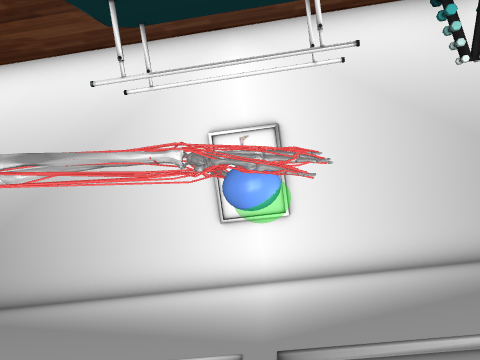
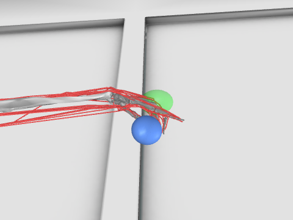
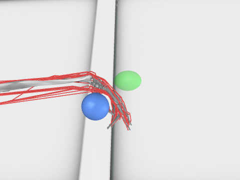
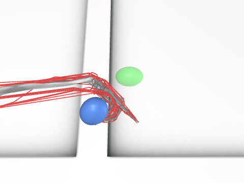

# MyoSuite smoke test: `myoHandObjHoldFixed-v0`

* MyoSuite 3.0.0, MuJoCo 3.17.0, Gymnasium 1.2.3
* Registry: 226 myo environments; 24 myoHand environments: `myoHandKeyTurnFixed-v0`, `myoHandKeyTurnRandom-v0`, `myoHandObjHoldFixed-v0`, `myoHandObjHoldRandom-v0`, `myoHandPenTwirlFixed-v0`, `myoHandPenTwirlRandom-v0`, `myoHandPose0Fixed-v0`, `myoHandPose1Fixed-v0`, `myoHandPose2Fixed-v0`, `myoHandPose3Fixed-v0`, `myoHandPose4Fixed-v0`, `myoHandPose5Fixed-v0`, `myoHandPose6Fixed-v0`, `myoHandPose7Fixed-v0`, `myoHandPose8Fixed-v0`, `myoHandPose9Fixed-v0`, `myoHandPoseFixed-v0`, `myoHandPoseRandom-v0`, `myoHandReachFixed-v0`, `myoHandReachRandom-v0`, `myoHandReorient100-v0`, `myoHandReorient8-v0`, `myoHandReorientID-v0`, `myoHandReorientOOD-v0`
* Chosen: `myoHandObjHoldFixed-v0` (hand holds an object; includes the wrist)
* Observation dim: (91,), action dim: (39,) (actions in [-1, 1])
* Random rollout: 200 steps, seed 0, 0.38 s wall, 9 resets, mean reward -10.510, no errors
* Model: 24 joints, 39 actuators (muscles), timestep 0.002 s, frame skip 10

## Wrist exposure (needed for Route B)

| wrist joint | range (deg) | muscles with moment arm > 0.1 mm at reset pose (mm) |
|---|---|---|
| `pro_sup` | [-90, 90] | PL +5.2, PT +5.0, FCU +4.5, FCR +4.4, FDS5 +4.2, FDS4 +4.0, ECU +2.5, EDC3 +2.0, FDS3 +1.9, EDC2 +1.8, EDC5 +1.8, ECRB +1.8, EDC4 +1.7, FDS2 +1.6, FDP4 +1.4, FDP3 +1.3, FDP5 +1.3, ECRL -1.2, FDP2 +0.9, EDM +0.4, PQ -0.1, EPL +0.1 |
| `deviation` | [-10, 25] | EPB +34.2, ECU -27.8, APL +26.8, ECRL +23.6, EPL +22.7, FPL +20.8, EDM -14.5, ECRB +14.2, FCU -10.6, EDC5 -10.6, FDP2 +9.6, FDS2 +9.6, EDC4 -9.1, FDS3 +7.3, PL +7.2, FDP3 +5.3, FCR +4.0, EIP -2.8, FDP4 +2.7, EDC2 +2.3, EDC3 -2.2, FDS4 +1.3, FDP5 +0.9, FDS5 -0.4 |
| `flexion` | [-45, 45] | PL +25.1, FCR +18.5, FCU +18.4, EDC3 -17.8, EDC4 -17.3, EDC2 -17.3, ECRB -15.3, FDS5 +15.3, FDS4 +14.9, FDS3 +14.6, FDS2 +14.1, EPL -13.4, EIP -12.8, FDP4 +11.8, FDP3 +11.7, ECRL -11.7, FDP5 +11.6, FDP2 +11.6, FPL +11.2, EDC5 -10.9, EDM -9.5, ECU -7.5, APL +6.8, EPB -1.0 |

Wrist muscles present by name: `ECRL`, `ECRB`, `ECU`, `FCR`, `FCU`, `PL` (6/6 of ECRL, ECRB, ECU, FCR, FCU, PL).

All joints: `pro_sup`, `deviation`, `flexion`, `cmc_abduction`, `cmc_flexion`, `mp_flexion`, `ip_flexion`, `mcp2_flexion`, `mcp2_abduction`, `pm2_flexion`, `md2_flexion`, `mcp3_flexion`, `mcp3_abduction`, `pm3_flexion`, `md3_flexion`, `mcp4_flexion`, `mcp4_abduction`, `pm4_flexion`, `md4_flexion`, `mcp5_flexion`, `mcp5_abduction`, `pm5_flexion`, `md5_flexion`, `object_free`

All actuators: `ECRL`, `ECRB`, `ECU`, `FCR`, `FCU`, `PL`, `PT`, `PQ`, `FDS5`, `FDS4`, `FDS3`, `FDS2`, `FDP5`, `FDP4`, `FDP3`, `FDP2`, `EDC5`, `EDC4`, `EDC3`, `EDC2`, `EDM`, `EIP`, `EPL`, `EPB`, `FPL`, `APL`, `OP`, `RI2`, `LU_RB2`, `UI_UB2`, `RI3`, `LU_RB3`, `UI_UB3`, `RI4`, `LU_RB4`, `UI_UB4`, `RI5`, `LU_RB5`, `UI_UB5`

## Frames (random actions, offscreen EGL render, camera `hand_side_exter`)

